# Grabbit

**Screenshots, screen recordings and AI-ready captures for Windows, macOS and Linux. Straight to the clipboard, sized for wherever you paste them.**

Tap **PrtScn** to grab, hold it to record. Draw on pictures and videos, cut recordings on a timeline, and say what you want so it's pasted into ChatGPT, Claude or Gemini with the picture in one go.

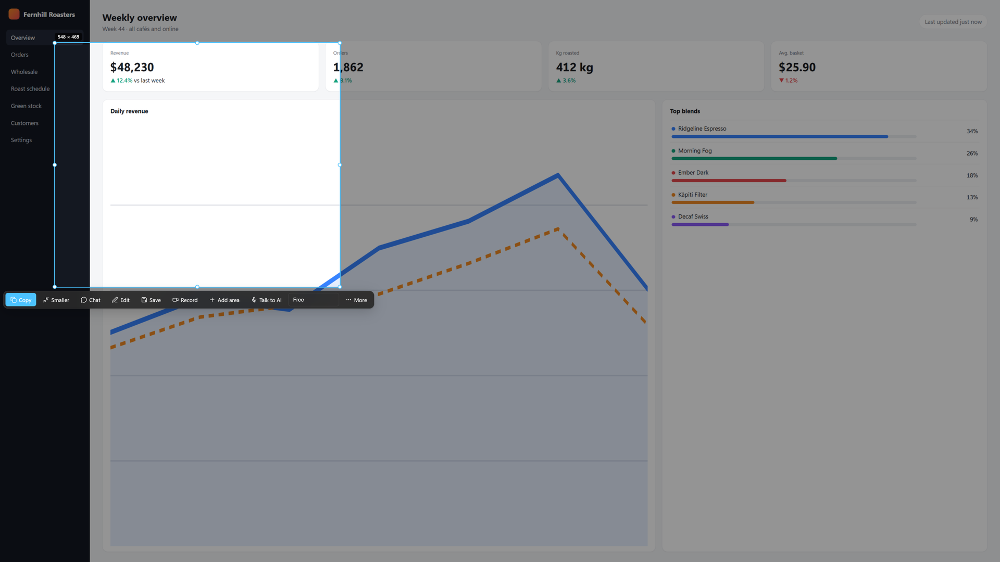

**[Download](https://github.com/JakeTheRabbit/grabbit/releases/latest)** · [Install](#install) · [Features](#features) · [Keys](#keys) · [Platforms](#what-differs-between-platforms) · [Privacy](#privacy) · [Build from source](#build-from-source)

---

## The 10-second tour

| Do this | Get this |
|---|---|
| **Tap** PrtScn (macOS: <kbd>⌘</kbd><kbd>⇧</kbd><kbd>2</kbd>) | The screens freeze. Drag an area, click a window, or press <kbd>F</kbd> for the whole screen. **Enter** copies it. |
| **Hold** it for 2 s | A pill fills up, then you pick what to record. Press the key again (or Stop) to finish. |
| Press **V** on a selection | Talk about it. Your words, the picture and the text on screen go on the clipboard for one paste into an AI chat. |

Everything else is one click away on the bar, and nothing has to be set up first.

## Features

**Capture**
- Region, window (captured whole even when covered), whole screen, or **up to 4 areas** combined side by side, stacked, as a grid, or as on screen.
- Move and resize the selection after you draw it; arrow keys nudge it (<kbd>Alt</kbd>+arrows resize).
- A pixel loupe with coordinates and colour (<kbd>C</kbd> copies the hex), a **measure** tool (<kbd>M</kbd>), and **size presets** for Instagram, Stories/Reels/TikTok/Snapchat, YouTube, X, LinkedIn, Facebook and Pinterest (<kbd>A</kbd>).
- **Scrolling capture** of long pages: Grabbit scrolls and stitches; sticky headers appear once.
- **Copy text** from anything on screen (OCR), **read QR codes**, **pin** a capture on top of everything, capture again **in 3 or 10 s**, **timed captures** that end as a timelapse.
- Every capture lands on the clipboard as a picture **and** a named file (chat apps attach it), and is saved as **lossless WebP** (pixel-exact at ~40 % of PNG). **Smaller** and **Chat** copies in one click.
- A **quick-access card** after each capture: drag the thumbnail straight into any app, or edit, pin, share, talk to AI.

**Talk to AI** — the most context in one paste
- Pick an area and press **Talk to AI** (<kbd>V</kbd>), or use it on any picture or video afterwards.
- Say what you want. **Click the picture to point, drag to box something:** the numbered marks go into your words where you made them, and the AI sees the same numbers on the picture.
- Your words appear in an **editable box** before anything is copied, so a misheard word is easy to fix.
- One <kbd>Ctrl</kbd>+<kbd>Enter</kbd> puts it all on the clipboard: the picture (with your words printed under it, so they survive any chat app), your words first, then context — the window, the time, and **the text on screen** read automatically so the model can quote exact labels and numbers.
- **Videos:** key frames from the moments something was said, each labelled with its time and the words, plus a timestamped transcript (and optionally the video file, for models that watch video).
- **AI batch:** start a batch and keep talking while you take screenshot after screenshot. Whatever you say after each capture belongs to that picture. Review them all, fix any words, and paste every picture with its own explanation in one go.
- **Describe & tag** (<kbd>X</kbd>): a paragraph explaining any screenshot and a set of tags, copied, kept in History, and searchable. Optionally for every capture automatically.

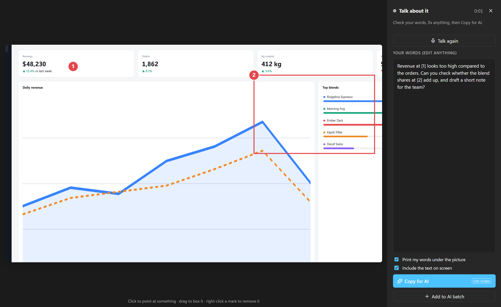

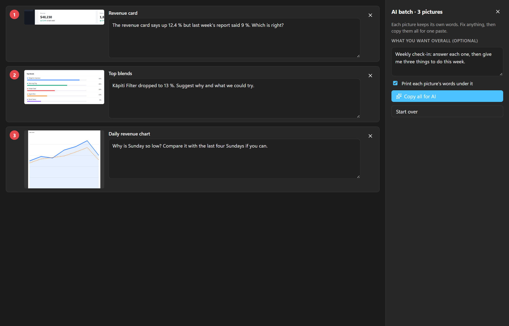

**Record**
- **Hold PrtScn for 2 s** (or <kbd>Ctrl</kbd>+<kbd>Alt</kbd>+<kbd>PrtScn</kbd>, or Record on the bar). A red frame and a small Stop bar sit beside the area and never appear in the video.
- **Pause**, then **move or resize the frame** before you carry on.
- **System sound and microphone on separate tracks**, chosen per copy later. Optional **webcam bubble**. Records your clicks and keys for the studio effects below.
- Hardware encoding where available (NVIDIA, Intel, AMD, Apple), x264 everywhere else. Recordings are crash-safe, stop by themselves before the disk fills, and show the time in the tray.
- **Replay buffer:** always keeps the last 10 s – 10 min; one key saves it.
- **Step recorder:** click through a task and get a **how-to** as Markdown and a Word document, a numbered picture per step.

**Edit pictures** — the [Excalidraw](https://github.com/excalidraw/excalidraw) editor, offline
- Arrows, boxes, text, pen, highlighter, numbered **steps**, emoji and icons, tabs and a recent-captures strip.
- **Hide** private details: one click finds and pixelates **emails, IP addresses, phone and card numbers, API keys and tokens** (or pixelate / blur / black out / spotlight any box).
- **Beautify:** padding, gradient or solid background, rounded corners, shadow, exact social sizes.
- **AI** (your own key, or a free local model): remove the background, remove or change what's in a box, change the text in a box, edit the whole picture, ask about it, describe & tag.

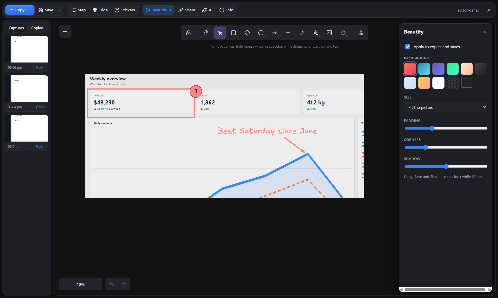

**Edit videos**
- Filmstrip timeline: split, cut parts out, trim, **speed a part up or down**, undo.
- **Cut silences** in one click. **Captions** made on your computer (or with OpenAI): edit the lines, ✂ cut a line's stretch out of the video, cut filler words, burn them in or keep the `.srt`.
- **Studio effects** from what was recorded: **auto-zoom on clicks** (eased in and out), **click rings**, **key captions** — all changeable after recording.
- **Draw** on the video (each drawing has its own bar on the timeline) and **blur boxes** that hide a region for exactly as long as you choose.
- Copy, Copy for chat (under 94 MB), GIF, animated WebP, a styled copy on a background, and every social size.

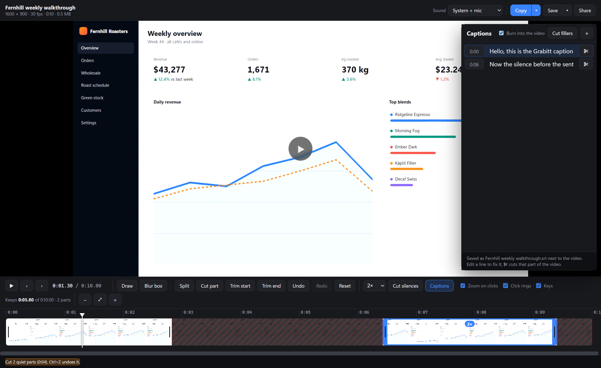

**Share and protect**
- **Share** uploads and copies the link: **OneDrive**, **Immich**, **MEGA**, any **S3-compatible** storage (AWS, Cloudflare R2, Backblaze B2, MinIO — the link is copied before the upload finishes), or **Send to Obsidian** (saved in your vault and linked in today's note).
- **Logo or watermark** on every picture and/or video.
- **Invisible watermark:** your name and the capture's id hidden in the pixels. It survives JPEG, re-saving and cropping; **Check image** reads it from a copy found elsewhere and names the original capture.
- **Metadata:** stripped from everything by default; add author, copyright and your own fields when you want them.
- **History:** search old captures by the words in them or what they show.

**Make it yours**
- Every key is configurable; **back up and restore** all settings as one file.
- `grabbit://capture`, `grabbit://record`, `grabbit://replay`, `grabbit://open/<file>` and the same words on the command line, for launchers and scripts.

## More screenshots

| | |
|---|---|
| 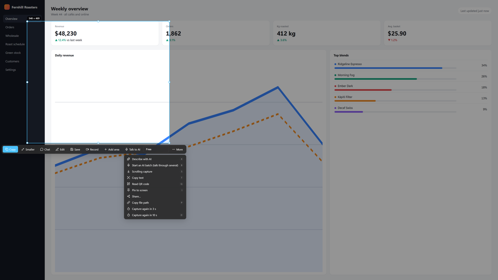 **More**: scrolling capture, copy text, QR, pin, describe, AI batch | 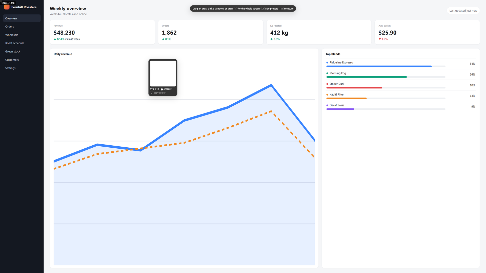 **Loupe**: coordinates and colour; <kbd>C</kbd> copies it |
| 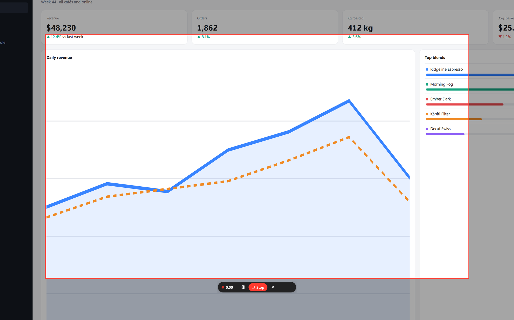 **Recording**: the frame and Stop bar stay out of the video | 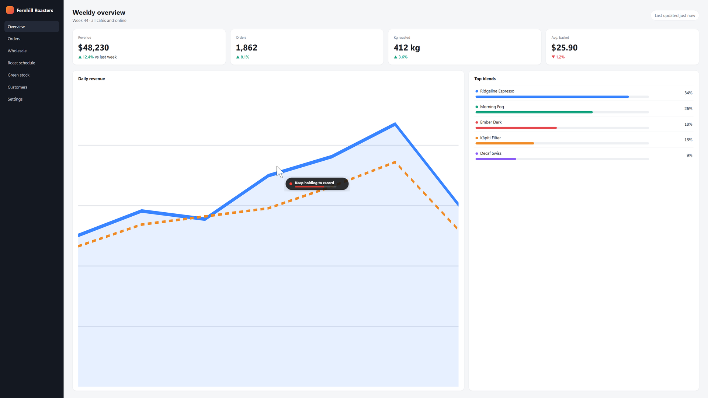 **Hold PrtScn**: let go early for a screenshot |
| 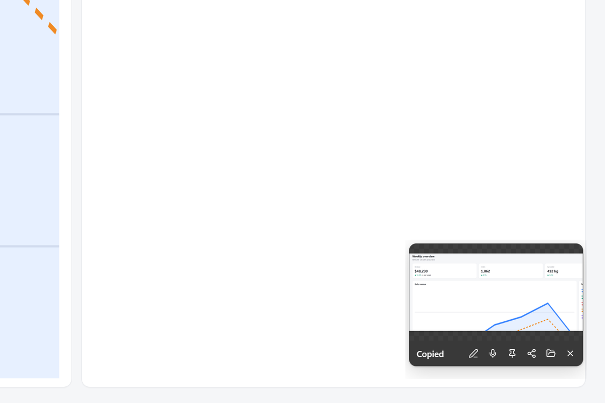 **After a capture**: drag the thumbnail into any app, or edit, talk to AI, pin, share | 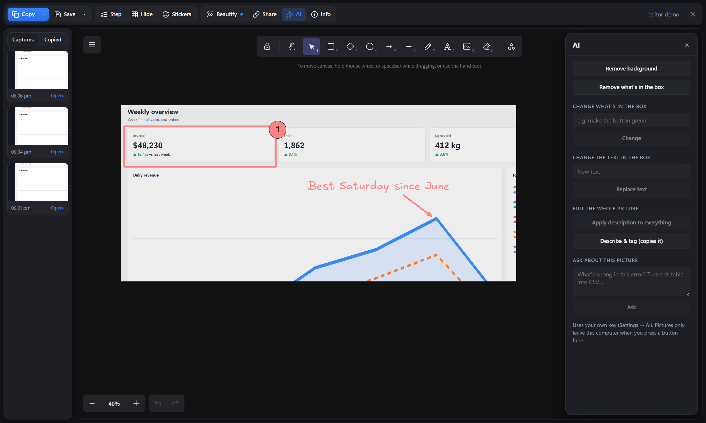 **Editor AI**: remove backgrounds and objects, change text, describe & tag |
| 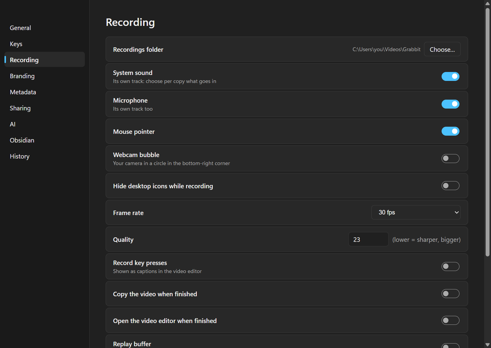 **Settings**: one page per area | 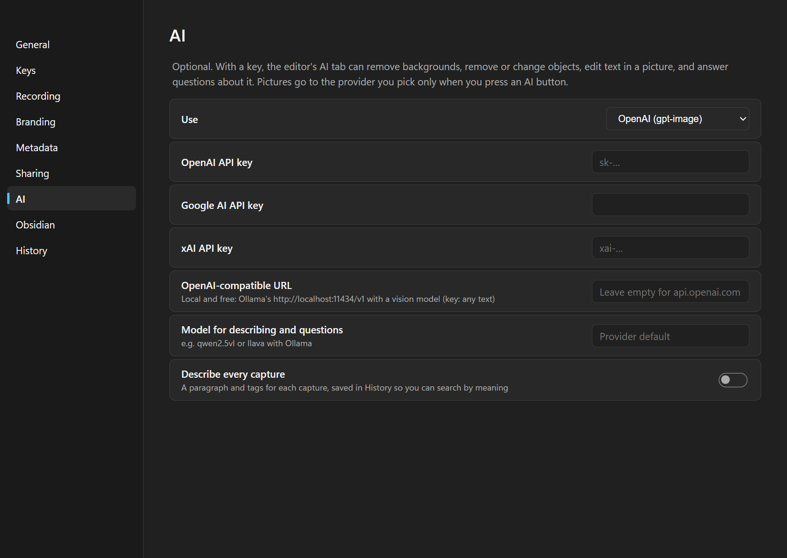 **AI**: your own key or a free local model |

All screenshots show a made-up dashboard ([docs/demo](docs/demo)) and are regenerated by `docs/demo/shoot-v3.mjs`.

## Install

Download from **[Releases](https://github.com/JakeTheRabbit/grabbit/releases/latest)**. The apps aren't signed with a paid certificate yet, so each OS asks once:

| | Download | First launch |
|---|---|---|
| **Windows 10/11** | `Grabbit_x64-setup.exe` (or `.msi`) | SmartScreen: **More info → Run anyway** |
| **macOS 13+** | `Grabbit_aarch64.dmg` (Apple silicon) or `Grabbit_x64.dmg` (Intel) | Drag to Applications, then **right-click → Open → Open**. Allow **Screen Recording** (and **Microphone**; **Accessibility** for scrolling capture and key captions) in System Settings → Privacy & Security. |
| **Linux** | `.AppImage` (any distro), `.deb` (Debian/Ubuntu), `.rpm` (Fedora/openSUSE) | AppImage: `chmod +x Grabbit*.AppImage` then run it. |

**Recording needs ffmpeg** (8.0 or newer for on-computer captions):

```bash
winget install Gyan.FFmpeg
```

```bash
brew install ffmpeg
```

```bash
sudo apt install ffmpeg tesseract-ocr
```

(The `.deb` installs both for you. **tesseract** is what Linux uses to read text; Windows and macOS have their own.)

PrtScn only works when no other screenshot tool has claimed it (Windows: turn off *Settings → Accessibility → Keyboard → Use the Print screen key to open screen capture*). Grabbit's log says which keys were taken, and every key can be changed in **Settings → Keys**. Turn on **Start with your computer** in Settings → General.

## Keys

| Picker | | Picker | |
|---|---|---|---|
| <kbd>Enter</kbd> | Copy | <kbd>E</kbd> | Edit |
| <kbd>Shift</kbd>+<kbd>Enter</kbd> | Copy smaller | <kbd>R</kbd> | Record this area |
| <kbd>V</kbd> | Talk to AI | <kbd>X</kbd> | Describe with AI |
| <kbd>N</kbd> | Add another area (up to 4) | <kbd>B</kbd> | Start an AI batch |
| <kbd>T</kbd> | Copy text | <kbd>Q</kbd> | Read QR code |
| <kbd>S</kbd> | Scrolling capture | <kbd>I</kbd> | Pin on top |
| <kbd>P</kbd> | Copy file path | <kbd>Ctrl</kbd>/<kbd>⌘</kbd>+<kbd>S</kbd> | Save as… |
| <kbd>F</kbd> | Whole screen | <kbd>L</kbd> | Last area again |
| <kbd>C</kbd> | Copy the colour | <kbd>M</kbd> | Measure |
| <kbd>A</kbd> | Size presets | <kbd>D</kbd> | Again in 10 s |
| <kbd>Esc</kbd> | Back / close | Right-click | Back / close |

Holding <kbd>Ctrl</kbd> / <kbd>Shift</kbd> / <kbd>Alt</kbd> as you let go of a drag goes straight to the editor / a smaller copy / a chat copy. <kbd>Ctrl</kbd>+click windows to capture several together.

Global keys (all changeable in Settings → Keys):

| | Windows / Linux | macOS |
|---|---|---|
| Capture (tap) / record (hold) | <kbd>PrtScn</kbd> | <kbd>⌘</kbd><kbd>⇧</kbd><kbd>2</kbd> |
| Same area as last time | <kbd>Shift</kbd>+<kbd>PrtScn</kbd> | <kbd>⌘</kbd><kbd>⇧</kbd><kbd>⌥</kbd><kbd>2</kbd> |
| Whole screen, no picker | <kbd>Ctrl</kbd>+<kbd>Shift</kbd>+<kbd>PrtScn</kbd> | <kbd>⌘</kbd><kbd>⇧</kbd><kbd>1</kbd> |
| Record (again to stop) | <kbd>Ctrl</kbd>+<kbd>Alt</kbd>+<kbd>PrtScn</kbd> | <kbd>⌘</kbd><kbd>⇧</kbd><kbd>⌥</kbd><kbd>R</kbd> |
| Save the replay buffer | <kbd>Ctrl</kbd>+<kbd>Alt</kbd>+<kbd>Shift</kbd>+<kbd>B</kbd> | <kbd>⌘</kbd><kbd>⇧</kbd><kbd>⌥</kbd><kbd>B</kbd> |
| Step recorder on / off | <kbd>Ctrl</kbd>+<kbd>Alt</kbd>+<kbd>Shift</kbd>+<kbd>T</kbd> | <kbd>⌘</kbd><kbd>⇧</kbd><kbd>⌥</kbd><kbd>T</kbd> |

## What differs between platforms

Everything above works on all three, with these exceptions:

| | Windows | macOS | Linux |
|---|---|---|---|
| Reading text (OCR) | Windows OCR | Apple Vision | tesseract |
| System sound in recordings | ✓ | ✓ (ScreenCaptureKit, macOS 13+) | ✓ (PulseAudio / PipeWire) |
| Global keys and recording | ✓ | ✓ | X11 sessions. On Wayland, bind `grabbit capture` / `grabbit record` to a desktop shortcut, and log in with an "Xorg" / X11 session to record |
| Hide desktop icons while recording | ✓ | — (macOS can only do it by restarting Finder) | — |
| Overlays kept out of recordings | ✓ | ✓ | Placed outside the recorded area |
| Hardware encoding | NVIDIA, Intel, AMD | Apple | via x264 |

## Privacy

- Nothing leaves your computer unless you press **Share** or an **AI** button. Captions and OCR run on your computer (Linux OCR via tesseract; captions download a 148 MB speech model once, or use OpenAI if you choose).
- AI features use **your own key** (OpenAI, Google, xAI) or a **local model** — any OpenAI-compatible address works, e.g. Ollama's `http://localhost:11434/v1` with a vision model.
- Metadata is stripped from everything by default.
- Settings (including keys you add) live in one file: `%APPDATA%\Grabbit`, `~/Library/Application Support/Grabbit`, or `~/.config/grabbit`. **Back up** leaves keys out unless you tick the box.

## Build from source

Needs [Rust](https://rustup.rs), [Bun](https://bun.sh) and, for recording, ffmpeg. Linux also needs the WebKitGTK and capture libraries listed in [the CI workflow](.github/workflows/build.yml).

```bash
git clone https://github.com/JakeTheRabbit/grabbit
cd grabbit/app
bun install
bunx tauri build
```

```bash
bunx tauri build --debug --no-bundle
./src-tauri/target/debug/grabbit --self-test out
```

- `--self-test` captures the screens, round-trips every encoder, metadata and the watermark, reads text, checks the clipboard, records 3 s and renders cuts, speed, GIF and social sizes; CI runs it on Windows, macOS and Linux.
- `cargo test --lib` (in `app/src-tauri`) covers the watermark, stitching, layouts, captions, studio effects, S3 signing, settings backup and more.
- `spikes/all.ps1` runs the Windows end-to-end flows (picker, recording, both editors, scrolling, Talk to AI) over DevTools.
- The original Windows-only WPF version is kept in [`legacy/windows-wpf`](legacy/windows-wpf).

## Credits

[Tauri](https://tauri.app) · [Excalidraw](https://github.com/excalidraw/excalidraw) (MIT) · [ffmpeg](https://ffmpeg.org) (LGPL/GPL, run as a separate program) · [whisper.cpp](https://github.com/ggml-org/whisper.cpp) via ffmpeg · [xcap](https://github.com/nashaofu/xcap) · [cpal](https://github.com/RustAudio/cpal) · [ScreenCaptureKit-rs](https://github.com/doom-fish/screencapturekit-rs) · [Lucide](https://lucide.dev) icons (ISC).

## Licence

MIT, see [LICENSE](LICENSE).
