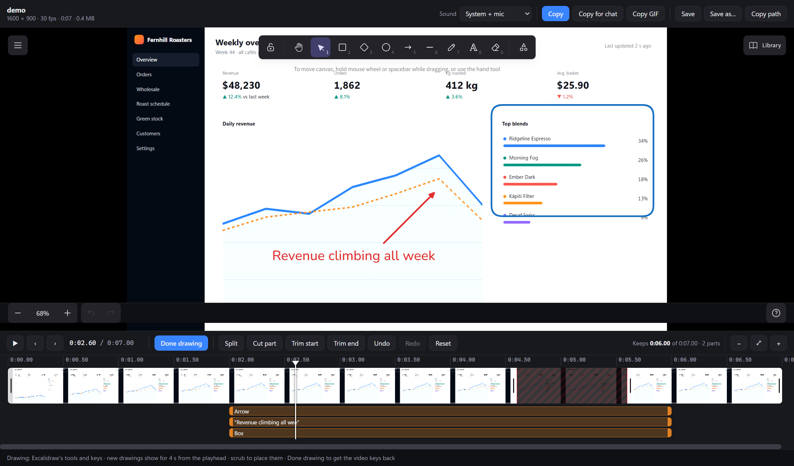

# Grabbit

**Screenshots and screen recordings for Windows 11, straight to the clipboard, sized for wherever you paste them.**

Tap **PrtScn** to grab, hold it to record. Annotate pictures and videos with a full drawing editor. Trim and cut recordings on a timeline. Paste into Signal, Slack, Word or anywhere else as the right kind of file.


## Features

**Capture**
- Tap **PrtScn** to freeze every screen, then pick a region, window or whole screen. An 8× pixel loupe shows coordinates, size and colour.
- Ctrl+click several windows to capture them together, each grabbed whole even when covered.
- **Scrolling capture** of long pages and documents, stitched seamlessly (sticky headers appear once).
- One action bar: **Copy · Smaller · Chat size · Edit · Scroll · Save · Copy path · Record**.

**Clipboard that pastes everywhere**
- PNG + DIBV5 (keeps transparency in Office) + DIB + a real file, so chat apps attach it with a name.
- **Smaller** (long edge ≤ 1920 px) and **Chat** (JPEG ≤ 2 MB) copies in one click.
- Everything is saved full-size as **lossless WebP**: pixel-exact at about 40 % of PNG's size.

**Record**
- **Hold PrtScn for 2 s** to record an area, a window or a screen. A red frame and a small Stop bar sit beside it and never appear in the video.
- GPU capture and encoding (Desktop Duplication + NVENC H.264; x264 without NVIDIA).
- **System sound and microphone on separate tracks**: choose later what goes into each copy.
- The finished `.mp4` lands on the clipboard as a file and opens in the video editor.

**Edit pictures**: the [Excalidraw](https://github.com/excalidraw/excalidraw) editor, offline
- Arrows, boxes, text, pen, highlighter and numbered steps.
- **Pixelate · Blur · Black out** for anything sensitive, plus **Spotlight**.
- Emoji and icons, tabs, a recent-captures strip, and saving as an editable `.excalidraw` file.

**Edit videos**
- A filmstrip timeline: scrub, frame-step, **split**, **cut parts out**, trim the ends, undo.
- **Draw on the video with Excalidraw.** Each drawing has its own bar on the timeline, so you choose exactly when it shows.
- **Sound picker**: system + mic, either one, or no sound.
- **Copy**, **Copy for chat** (under 94 MB for Signal), **Copy GIF**, **Save**.

## Screenshots

| | |
|---|---|
|  **Hold PrtScn**: the pill fills; let go early for a screenshot |  **Recording**: the frame and Stop bar stay out of the video |
|  **Picture editor**: Excalidraw with Grabbit's copy, redact and step tools |  **Video editor**: a cut part (hatched), drawings on their own lanes, sound picker |


*Drawing on a recording. The drawings are burned into the exported video only while their bars are under the playhead.*

## Install

Needs Windows 10 2004+ / Windows 11, the [.NET 10 SDK](https://dotnet.microsoft.com/download), [Bun](https://bun.sh) (builds the editors) and, for recording, [ffmpeg](https://ffmpeg.org) (`winget install Gyan.FFmpeg`).

```bash
git clone https://github.com/JakeTheRabbit/grabbit
cd grabbit/src/editor-web && bun install && bun run build && cd ../..
dotnet build src/Grabbit/Grabbit.csproj -c Release
src/Grabbit/bin/Release/net10.0-windows/Grabbit.exe
```

Grabbit sits in the tray. Turn on *Start with Windows* from its menu.

PrtScn only works when no other screenshot tool (Greenshot, or Snipping Tool's "Print Screen opens screen capture" setting) has claimed it. Grabbit tells you at start-up which keys were taken, and **Ctrl+Alt+G** always works.

## Keys and actions

| Do this | Get this |
|---|---|
| Tap **PrtScn** (or **Ctrl+Alt+G**, or left-click the tray icon) | Screens freeze with the loupe. Drag a region, click a window, or press **F** for the whole screen. The bar opens at the mouse. Keys: Enter = Copy, E = Edit, S = Scroll, R = Record, Ctrl+S = Save, P = Copy path, Esc = pick again |
| Hold **Ctrl** / **Shift** / **Alt** as you let go | Straight into the editor / copy smaller / copy chat-sized |
| **Ctrl+click** windows in the picker | Multi-window capture, laid out as on screen, transparent between windows |
| **Scroll** on the bar (S) · **Ctrl+Alt+Shift+S** | Scrolling capture. Click a window to get everything you could scroll to; drag an area to scroll down from there |
| **Ctrl+Shift+PrtScn** | The screen under the cursor, no picker |
| **Hold PrtScn 2 s** · **Ctrl+Alt+PrtScn** · **Record** on the bar | Pick an area and record it. Hold time: `HoldToRecordMs` in settings (0 = off) |
| **PrtScn** / **Ctrl+Alt+PrtScn** again · **Stop** · tray icon | Stop: `.mp4` in `Videos\Grabbit`, on the clipboard as a file, open in the video editor |
| `Grabbit.exe --open <image, .excalidraw or video>` | Open it in the right editor |

### How scrolling capture works

Grabbit asks the app to scroll rather than faking your mouse:
1. **UI Automation** works in Edge, Chrome, Office, File Explorer and WPF/WinForms apps. It moves by half the visible area each step.
2. **Posted mouse-wheel messages** are used if the app has no automation scroll.
3. **Manual:** if neither works, you scroll yourself and Grabbit stitches whatever comes into view.

Frames are matched on a per-row brightness profile, which tolerates the anti-aliasing changes from fractional scrolling at 125/150 % scaling.

### Recording

- **Picture:** ffmpeg's Desktop Duplication (`ddagrab`) of the monitor the area is on, cropped on the GPU and encoded with NVENC. An area spanning two screens is cut to the screen holding its centre.
- **Sound:** system sound (WASAPI loopback, kept ticking with silence so quiet parts stay in sync) and the microphone go into **separate tracks** named *System sound* and *Microphone*.
- **Options** (tray → *Recording options*): system sound, microphone, mouse pointer, 60 fps, copy when finished, open the editor when finished. `RecordQuality` (default 23) is in the settings file.

### Video editor

| Do this | Get this |
|---|---|
| Click / drag the timeline · ← → (Shift = 1 s) · Space | Scrub · step a frame · play (cut parts are skipped) |
| **S** · select a part + **Delete** · **I** / **O** · drag a part's edge | Split · cut it out · cut everything before / after the playhead · trim |
| **Draw** (D) | Excalidraw over the video. New drawings show for 4 s from the playhead; drag a drawing's bar (or its ends) on the timeline to change when |
| **Sound** | System + mic (mixed into one track, which is what chat apps play) · system only · mic only · no sound |
| **Copy** · **Copy for chat** · **Copy GIF** · **Save** / **Save as…** / **Copy path** | Clipboard file · ≤ 1920 px under 94 MB · 12 fps GIF · `… edited.mp4` next to the original (never overwrites) |

An untouched video is copied as the original file; cuts, drawings or a sound change are rendered with ffmpeg. Closing with unsaved edits asks whether to keep them as a new video.

### Picture editor

[Excalidraw](https://github.com/excalidraw/excalidraw) (MIT), bundled and offline: shapes, arrows, text, pen, styling, layers, align, group, crop, library and undo. Grabbit adds:
- **Copy · Smaller · Chat · Copy & close · Save · Copy path · Save as… · Editable** (`.excalidraw`).
- **Step** adds numbered badges.
- **Pixelate · Blur · Black out:** these are baked into the pixels. **Spotlight** dims everything else.
- **Stickers:** 64 emoji and 70 Lucide icons.
- The **recent strip** of captures and copies, and **tabs**.

Closing with changes keeps them as `<name> edited.png`.

### Files and settings

- **Pictures:** `Pictures\Grabbit`, lossless WebP. PNG is used past WebP's 16,383 px limit, or set `SaveFormat` to `Png`.
- **Recordings:** `Videos\Grabbit`.
- **Settings:** tray → *Edit settings file…* (`%APPDATA%\Grabbit\settings.json`).
- **Log:** `%APPDATA%\Grabbit\log.txt`.

| Lossless format (10 real captures) | Size vs PNG | Pixel-exact |
|---|---|---|
| PNG (GDI+) | 100 % | ✅ |
| PNG, max-optimized | 92 % | ✅ |
| **WebP lossless** | **~41 %** | ✅ |
| AVIF "lossless" | 25 % | ❌ changed pixels |

## Development

```bash
dotnet build src/Grabbit/Grabbit.csproj
src/Grabbit/bin/Debug/net10.0-windows/Grabbit.exe --selftest out      # capture, every clipboard size, editor, picker loupe; exit 0 = pass
src/Grabbit/bin/Debug/net10.0-windows/Grabbit.exe --record-test out   # 4 s recording, sound tracks, overlay not in the video, cut/chat/GIF renders
```

- **Editor pages:** rebuild after changing `src/editor-web` with `bun run build`; it writes to `src/Grabbit/EditorWeb`.
- **CDP tests:** the scripts in `spikes/` drive the real editors over DevTools. Run Grabbit with `WEBVIEW2_ADDITIONAL_BROWSER_ARGUMENTS=--remote-debugging-port=9333`. `p9-video-draw.mjs` draws on a video with real mouse input and exports it.
- **README screenshots:** `docs/demo/` makes them from a made-up demo page. `GRABBIT_DEMO=<folder>` keeps Grabbit's overlays visible to screen capture and its files in that folder.
- **Design notes and spike results:** [docs/PLAN.md](docs/PLAN.md).

## Credits

[Excalidraw](https://github.com/excalidraw/excalidraw) (MIT) · [ffmpeg](https://ffmpeg.org) (LGPL/GPL, run as a separate program) · [NAudio](https://github.com/naudio/NAudio) (MIT) · [Imazen.WebP](https://github.com/imazen/libwebp-net) · [WebView2](https://developer.microsoft.com/microsoft-edge/webview2/) · [Lucide](https://lucide.dev) icons (ISC).

## Licence

MIT, see [LICENSE](LICENSE).
