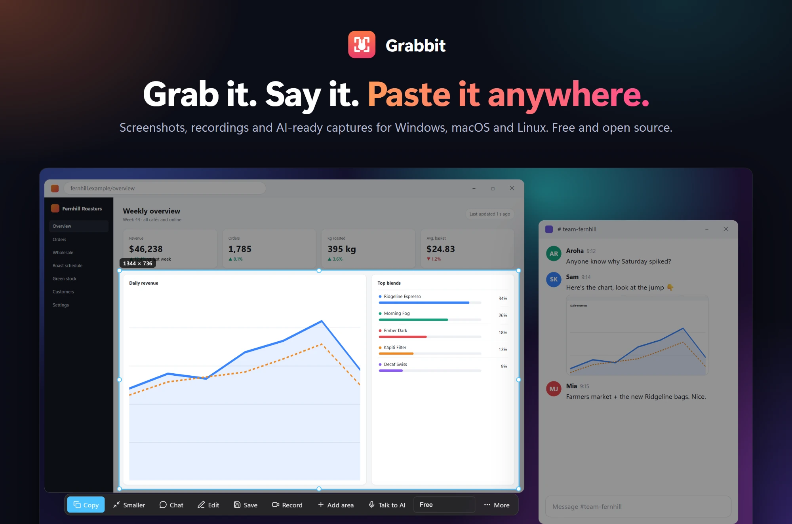
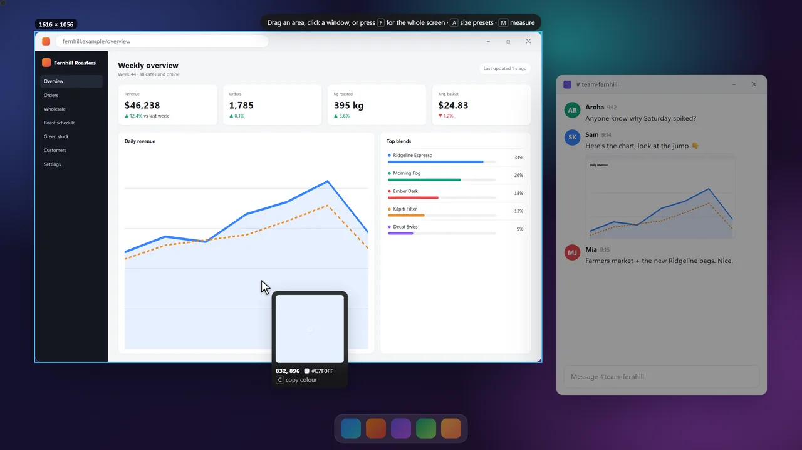
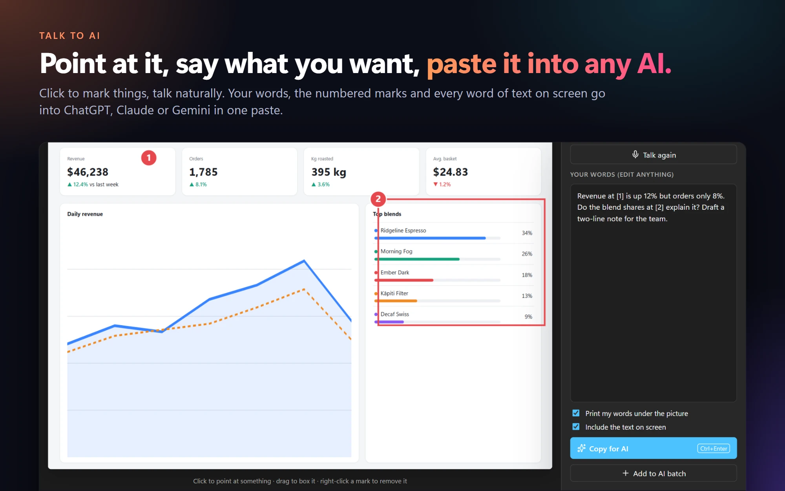
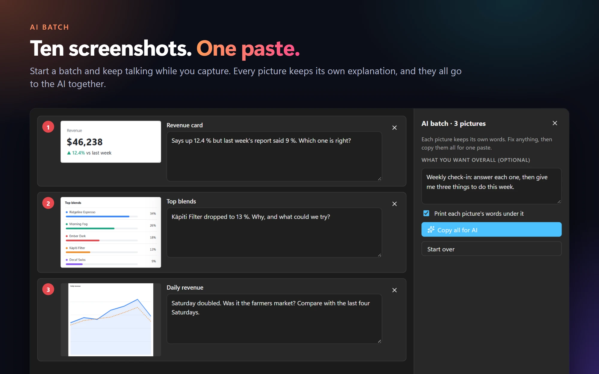
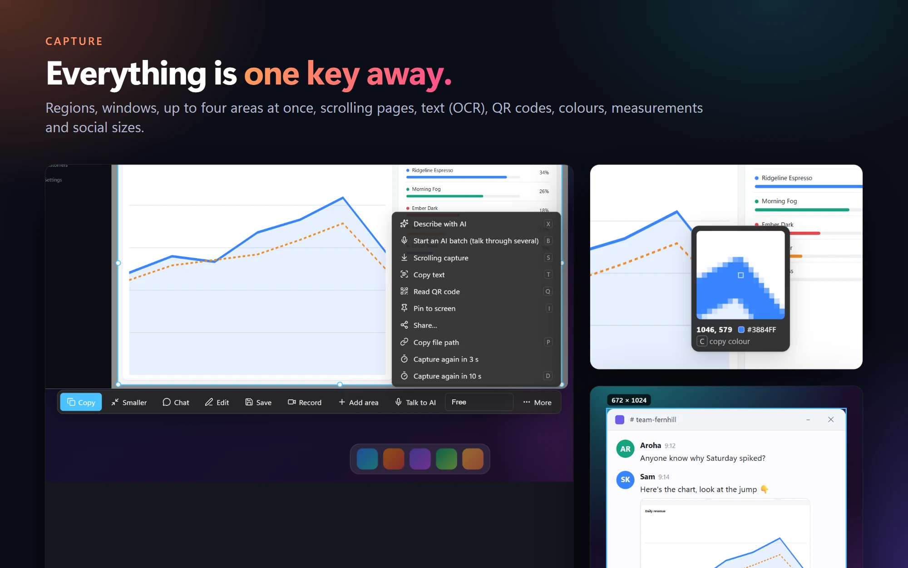
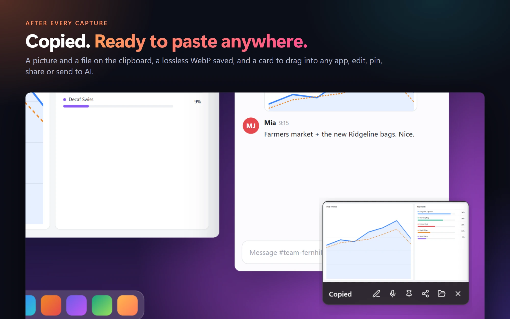
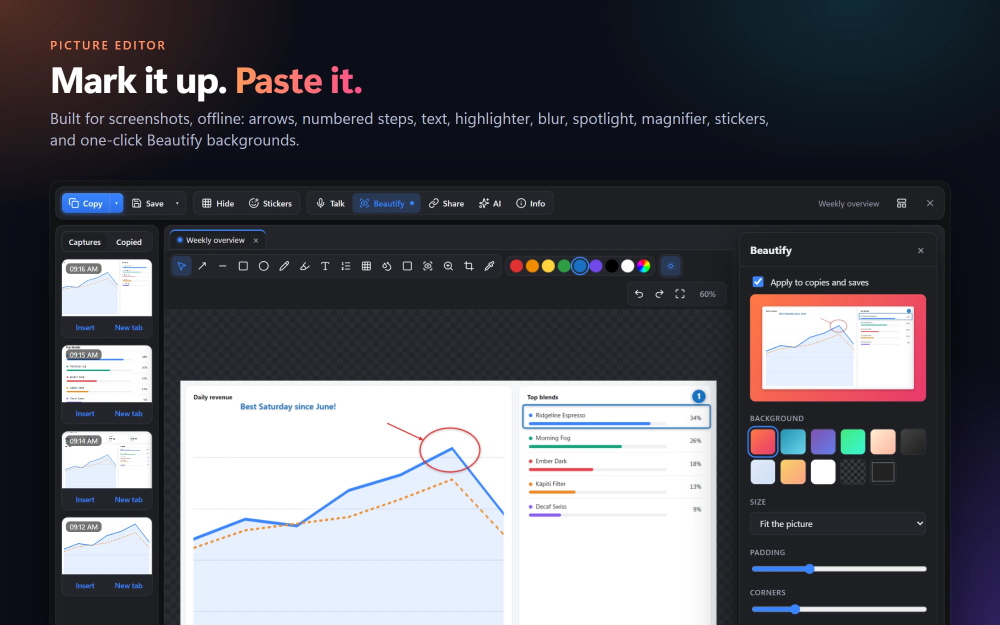
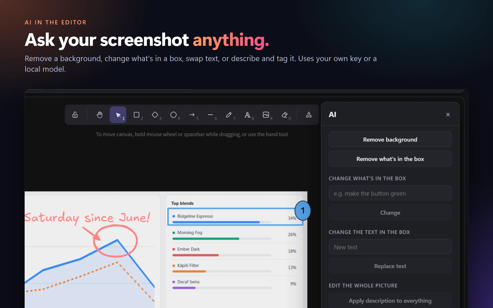
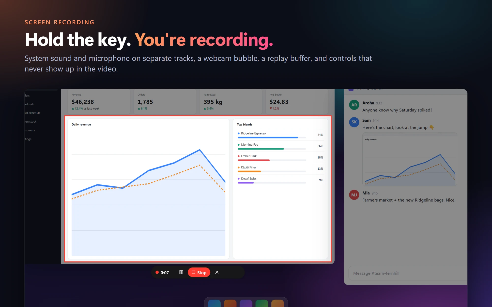
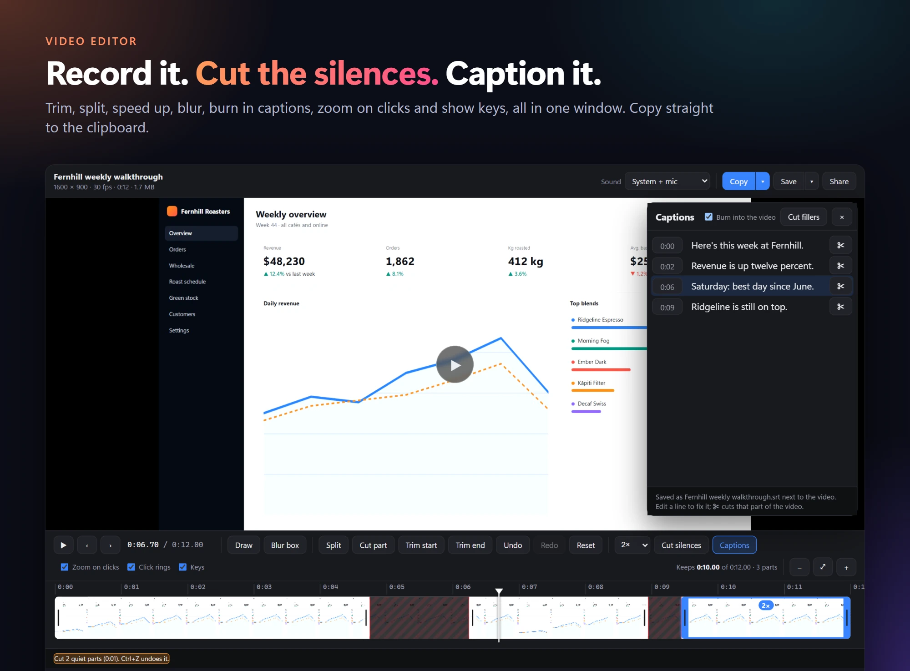

<p align="center">
  
</p>

<p align="center">
  <b>Tap PrtScn to grab. Hold it to record. Say what you want and paste it straight into ChatGPT, Claude or Gemini.</b><br>
  The screenshot and screen-recording app that does the boring part for you. Free, open source, no account, no watermark.
</p>

<p align="center">
  <a href="https://github.com/JakeTheRabbit/grabbit/releases/latest"></a>
  
  <a href="LICENSE"></a>
  <a href="https://github.com/JakeTheRabbit/grabbit/stargazers"></a>
  <a href="https://github.com/JakeTheRabbit/grabbit/actions/workflows/build.yml"></a>
</p>

<p align="center">
  <a href="https://github.com/JakeTheRabbit/grabbit/releases/latest"><b>⬇ Download Grabbit</b></a> &nbsp;·&nbsp;
  <a href="#install">Install</a> &nbsp;·&nbsp;
  <a href="#features">Features</a> &nbsp;·&nbsp;
  <a href="#keys">Keys</a> &nbsp;·&nbsp;
  <a href="#privacy">Privacy</a> &nbsp;·&nbsp;
  <a href="#build-from-source">Build</a> &nbsp;·&nbsp;
  <a href="CHANGELOG.md">Changelog</a> &nbsp;·&nbsp;
  <a href="CONTRIBUTING.md">Contribute</a>
</p>

---

<p align="center">
  
</p>

## Why Grabbit

- **One key does it all.** Tap PrtScn for a screenshot, hold it for a recording. No mode switching, no setup.
- **Built for pasting into AI.** Point at things, say what you mean, and one paste gives the AI the picture, your words, numbered marks and every word of text on the screen.
- **A real editor for pictures and video.** A markup editor built for screenshots (the Excalidraw whiteboard is still a click away), and a timeline that cuts silences, adds captions and zooms on your clicks.
- **Lands ready to use.** Every capture is on the clipboard as a picture *and* a file, saved as lossless WebP, with a card you can drag into any app.
- **Private by default.** Nothing leaves your computer until you press Share or an AI button. AI uses your own key or a local model.
- **Everywhere you work.** Windows, macOS and Linux, from one codebase, all free.

## Features

### Talk to AI



Pick an area and press <kbd>V</kbd>. Click to point, drag to box, and talk. Your words show up in an editable box, so a misheard word is a two-second fix. <kbd>Ctrl</kbd>+<kbd>Enter</kbd> copies everything for one paste: the picture with your words printed under it, the numbered marks, the window and time, and the text on screen read automatically, so the AI can quote exact labels and numbers. It works on videos too: key frames from the moments you spoke, each with its time and words, plus a timestamped transcript.

### AI batch



Start a batch (<kbd>B</kbd>) and keep talking while you take screenshot after screenshot. Whatever you say after each capture belongs to that picture. Review them, fix any words, and paste them all into the AI in one go. **Describe & tag** (<kbd>X</kbd>) writes a paragraph and tags for any capture, kept in History and searchable.

### Capture anything



- Region, window (captured whole even when covered), whole screen, or **up to 8 areas** across all your screens (<kbd>Ctrl</kbd>+drag adds one), kept as separate pictures or joined side by side, stacked, as a grid, or as they sit on screen.
- **Scrolling capture** of long pages: Grabbit scrolls and stitches, and sticky headers appear once.
- **Copy text** (OCR), **read QR codes**, **pin** a capture on top of everything, capture again **in 3 or 10 s**, timed captures that end as a timelapse.
- A pixel loupe with coordinates and colour (<kbd>C</kbd> copies the hex), a **measure** tool, and **size presets** for Instagram, Stories/Reels/TikTok, YouTube, X, LinkedIn, Facebook and Pinterest.
- Move and resize the selection after you draw it; arrow keys nudge it.

### Ready to paste, everywhere



Every capture lands on the clipboard as a picture **and** a named file (so chat apps attach it), and is saved as **lossless WebP**: pixel-exact at about 40 % of PNG's size. **Smaller** and **Chat** copies are one click. The Copied card lets you drag the thumbnail straight into any app, or edit, pin, share or talk to AI.

### Mark it up



Built for screenshots and fully offline: the capture is the canvas. Arrows, lines, boxes, ellipses, text, pen, highlighter, numbered **steps**, pixelate, blur, black out, spotlight, magnifier, crop, emoji and icons, tabs, and a strip of recent captures; every tool has a key ([docs/markup-editor.md](docs/markup-editor.md)). The classic [Excalidraw](https://github.com/excalidraw/excalidraw) whiteboard is in the layout menu, and `.excalidraw` projects open there.

- **Hide** private details in one click: finds and pixelates **emails, IP addresses, phone and card numbers, API keys and tokens**. Or pixelate, blur, black out or spotlight any box.
- **Beautify:** padding, gradient or solid background, rounded corners, shadow, exact social sizes. Use it on every copy, or **apply it to the picture** you're editing.
- **Pictures on pictures:** drag any capture from the side panel onto the canvas, then give it a **frame**: border colour, width and opacity, rounded corners, and how see-through it is.
- **Layers:** everything you add is a layer you can reorder, hide, select or delete. Ctrl+Z undoes all of it.
- Resizing keeps proportions (hold <kbd>Shift</kbd> to stretch), and text can use **any font on your computer**.
- **Captures panel:** every picture and recording grouped by day, with sort, a calendar, a pictures/videos filter, folders, and list or thumbnail views. Dock it on any side. Open pictures sit in **vertical tabs** with thumbnails.



**AI in the editor** (your own key or a free local model): remove the background, remove or change what's in a box, change the text in a box, edit the whole picture, ask about it, describe and tag it.

### Record your screen



- **Hold PrtScn for 2 s** (or <kbd>Ctrl</kbd>+<kbd>Alt</kbd>+<kbd>PrtScn</kbd>, or Record on the bar). Let go early and you get a screenshot instead.
- The red frame and Stop bar **never appear in the video**. **Pause**, then move or resize the frame before you carry on.
- **System sound and microphone on separate tracks**, picked per copy later. Optional **webcam bubble**. Your clicks and keys are recorded for the studio effects.
- Hardware encoding where available (NVIDIA, Intel, AMD, Apple), x264 everywhere else. Crash-safe, and it stops by itself before the disk fills.
- **Replay buffer:** always keeps the last 10 s to 10 min; one key saves it.
- **Step recorder:** click through a task and get a **how-to** as Markdown and a Word document, with a numbered picture per step.

### Edit the video



- Filmstrip timeline: split, cut parts out, trim, **speed a part up or down**, undo.
- **Cut silences** in one click. **Captions** made on your computer (or with OpenAI): edit lines, ✂ cut a line's stretch out of the video, cut filler words, burn them in or keep the `.srt`.
- **Studio effects** from what was recorded: **auto-zoom on clicks**, **click rings** and **key captions**, all changeable after recording.
- **Draw** on the video and add **blur boxes** that hide a region for exactly as long as you choose.
- Copy, Copy for chat (under 94 MB), GIF, animated WebP, a styled copy on a background, and every social size.

### Share and protect

- **Share** uploads and copies the link: **OneDrive**, **Immich**, **MEGA**, any **S3-compatible** storage (AWS, Cloudflare R2, Backblaze B2, MinIO; the link is copied before the upload finishes), or **Send to Obsidian**.
- **Logo or watermark** on pictures and videos, plus an **invisible watermark**: your name and the capture's id hidden in the pixels. It survives JPEG, re-saving and cropping, and **Check image** names the original capture.
- **Metadata** is stripped from everything by default; add author, copyright and your own fields when you want them.
- **History:** search old captures by the words in them or what they show.

### Make it yours

<table>
  <tr>
    <td width="50%"></td>
    <td width="50%"></td>
  </tr>
</table>

- **Light and dark mode**, or follow the system. Every window switches at once, title bars included.
- Every key is configurable, and all settings **back up and restore** as one file.
- **Light on your computer:** under 10 MB of memory while idle. The capture screens are built when you press the key and closed a minute later; turn on **Keep the capture screen ready** for instant captures.
- **Looks after itself:** Windows restarts Grabbit after a crash or hang, recording helpers close with it, a damaged settings file is replaced with the last good copy, and old temporary files are cleared.
- `grabbit://capture`, `grabbit://record`, `grabbit://replay`, `grabbit://open/<file>` and the same words on the command line, for launchers and scripts.

## Install

Download from **[Releases](https://github.com/JakeTheRabbit/grabbit/releases/latest)**. The apps aren't signed with a paid certificate yet, so each OS asks once:

| | Download | First launch |
|---|---|---|
| **Windows 10/11** | `Grabbit_x64-setup.exe` (or `.msi`) | SmartScreen: **More info → Run anyway** |
| **macOS 13+** | `Grabbit_aarch64.dmg` (Apple silicon) or `Grabbit_x64.dmg` (Intel) | Drag to Applications, then **right-click → Open → Open**. Allow **Screen Recording** (and **Microphone**; **Accessibility** for scrolling capture and key captions) in System Settings → Privacy & Security. |
| **Linux** | `.AppImage`, `.deb` (Debian/Ubuntu), `.rpm` (Fedora/openSUSE). Needs a 2024-or-newer distro (glibc 2.39+: Ubuntu 24.04, Debian 13, Fedora 40) | AppImage: `chmod +x Grabbit*.AppImage` then run it. |

**Recording needs ffmpeg** (8.0 or newer for on-computer captions):

```bash
winget install Gyan.FFmpeg
```

```bash
brew install ffmpeg
```

```bash
sudo apt install ffmpeg tesseract-ocr
```

(The `.deb` installs both for you. **tesseract** is what Linux uses to read text; Windows and macOS have their own.)

**If Grabbit vanishes on Windows**, Microsoft Defender has probably quarantined it. Defender's machine-learning guesses (`Behavior:Win32/Persistence.A!ml`, `Trojan:Win32/Bearfoos.A!ml`) flag unsigned apps that watch a key, capture the screen and start with Windows, which describes any screenshot tool. Grabbit is open source and built in public on GitHub Actions; signed builds are on the way ([docs/signing.md](docs/signing.md)). To get it back: **Windows Security → Virus & threat protection → Protection history**, open the Grabbit entry, then **Actions → Restore**, and reinstall if the shortcut is gone.

PrtScn only works when no other screenshot tool has claimed it (Windows: turn off *Settings → Accessibility → Keyboard → Use the Print screen key to open screen capture*). Grabbit's log says which keys were taken, and every key can be changed in **Settings → Keys**. Turn on **Start with your computer** in Settings → General.

## Keys

| Do this | Get this |
|---|---|
| **Tap** PrtScn (macOS: <kbd>⌘</kbd><kbd>⇧</kbd><kbd>2</kbd>) | The screens freeze. Drag an area, click a window, or press <kbd>F</kbd> for the whole screen. **Enter** copies it. |
| **Hold** it for 2 s | A pill fills up, then you pick what to record. Press the key again (or Stop) to finish. |
| Press **V** on a selection | Talk about it. Your words, the picture and the text on screen go on the clipboard for one paste into an AI chat. |

<details>
<summary><b>All keys</b></summary>

| Picker | | Picker | |
|---|---|---|---|
| <kbd>Enter</kbd> | Copy | <kbd>E</kbd> | Edit |
| <kbd>Shift</kbd>+<kbd>Enter</kbd> | Copy smaller | <kbd>R</kbd> | Record this area |
| <kbd>V</kbd> | Talk to AI | <kbd>X</kbd> | Describe with AI |
| <kbd>N</kbd> | Add another area (up to 8) | <kbd>B</kbd> | Start an AI batch |
| <kbd>T</kbd> | Copy text | <kbd>Q</kbd> | Read QR code |
| <kbd>S</kbd> | Scrolling capture | <kbd>I</kbd> | Pin on top |
| <kbd>P</kbd> | Copy file path | <kbd>Ctrl</kbd>/<kbd>⌘</kbd>+<kbd>S</kbd> | Save as… |
| <kbd>F</kbd> | Whole screen | <kbd>L</kbd> | Last area again |
| <kbd>C</kbd> | Copy the colour | <kbd>M</kbd> | Measure |
| <kbd>A</kbd> | Size presets | <kbd>D</kbd> | Again in 10 s |
| <kbd>Esc</kbd> | Back / close | Right-click | Back / close |

Holding <kbd>Ctrl</kbd> / <kbd>Shift</kbd> / <kbd>Alt</kbd> as you let go of a drag goes straight to the editor / a smaller copy / a chat copy. <kbd>Ctrl</kbd>+click windows to capture several together.

Global keys (all changeable in Settings → Keys):

| | Windows / Linux | macOS |
|---|---|---|
| Capture (tap) / record (hold) | <kbd>PrtScn</kbd> | <kbd>⌘</kbd><kbd>⇧</kbd><kbd>2</kbd> |
| Same area as last time | <kbd>Shift</kbd>+<kbd>PrtScn</kbd> | <kbd>⌘</kbd><kbd>⇧</kbd><kbd>⌥</kbd><kbd>2</kbd> |
| Whole screen, no picker | <kbd>Ctrl</kbd>+<kbd>Shift</kbd>+<kbd>PrtScn</kbd> | <kbd>⌘</kbd><kbd>⇧</kbd><kbd>1</kbd> |
| Record (again to stop) | <kbd>Ctrl</kbd>+<kbd>Alt</kbd>+<kbd>PrtScn</kbd> | <kbd>⌘</kbd><kbd>⇧</kbd><kbd>⌥</kbd><kbd>R</kbd> |
| Save the replay buffer | <kbd>Ctrl</kbd>+<kbd>Alt</kbd>+<kbd>Shift</kbd>+<kbd>B</kbd> | <kbd>⌘</kbd><kbd>⇧</kbd><kbd>⌥</kbd><kbd>B</kbd> |
| Step recorder on / off | <kbd>Ctrl</kbd>+<kbd>Alt</kbd>+<kbd>Shift</kbd>+<kbd>T</kbd> | <kbd>⌘</kbd><kbd>⇧</kbd><kbd>⌥</kbd><kbd>T</kbd> |

</details>

<details>
<summary><b>What differs between platforms</b></summary>

Everything above works on all three, with these exceptions:

| | Windows | macOS | Linux |
|---|---|---|---|
| Reading text (OCR) | Windows OCR | Apple Vision | tesseract |
| System sound in recordings | ✓ | ✓ (ScreenCaptureKit, macOS 13+) | ✓ (PulseAudio / PipeWire) |
| Global keys and recording | ✓ | ✓ | X11 sessions. On Wayland, bind `grabbit capture` / `grabbit record` to a desktop shortcut, and log in with an "Xorg" / X11 session to record |
| Hide desktop icons while recording | ✓ | — (macOS can only do it by restarting Finder) | — |
| Overlays kept out of recordings | ✓ | ✓ | Placed outside the recorded area |
| Hardware encoding | NVIDIA, Intel, AMD | Apple | via x264 |

</details>

## Privacy

- Nothing leaves your computer unless you press **Share** or an **AI** button. Captions and OCR run on your computer (Linux OCR via tesseract; captions download a 148 MB speech model once, or use OpenAI if you choose).
- AI features use **your own key** (OpenAI, Google, xAI) or a **local model**: any OpenAI-compatible address works, e.g. Ollama's `http://localhost:11434/v1` with a vision model.
- Metadata is stripped from everything by default.
- Settings (including keys you add) live in one file: `%APPDATA%\Grabbit`, `~/Library/Application Support/Grabbit`, or `~/.config/grabbit`. **Back up** leaves keys out unless you tick the box.

## Build from source

Needs [Rust](https://rustup.rs), [Bun](https://bun.sh) and, for recording, ffmpeg. Linux also needs the WebKitGTK and capture libraries listed in [the CI workflow](.github/workflows/build.yml).

```bash
git clone https://github.com/JakeTheRabbit/grabbit
cd grabbit/app
bun install
bunx tauri dev      # run it with live reload
bunx tauri build    # make the installers in src-tauri/target/release/bundle
```

<details>
<summary><b>Where things are</b></summary>

| Path | What |
|---|---|
| `app/src-tauri/src/` | The Rust core: hotkeys, capture, picker windows, recording (ffmpeg), OCR, export, sharing, AI, settings, self-test |
| `app/src/` | The web pages each window shows: the picture editors (`markup/` and the Excalidraw `App.tsx`), `video/`, `picker/`, `settings/`, `voice/`, `overlays/`, and the shared look in `ui/` |
| `docs/` | Editor guide, code-signing notes, plans, and the [studio](docs/demo/studio) that makes the README pictures and runs UI checks |
| `spikes/` | Windows end-to-end test scripts |
| `legacy/windows-wpf/` | The original Windows-only WPF version (0.1) |

</details>

<details>
<summary><b>Tests</b></summary>

```bash
bunx tauri build --debug --no-bundle
./src-tauri/target/debug/grabbit --self-test out
```

- `--self-test` captures the screens, round-trips every encoder, metadata and the watermark, reads text, checks the clipboard, records 3 s and renders cuts, speed, GIF and social sizes; CI runs it on Windows, macOS and Linux.
- `cargo test --lib` (in `app/src-tauri`) covers the watermark, stitching, layouts, captions, studio effects, S3 signing, settings backup and more.
- `spikes/all.ps1` runs the Windows end-to-end flows (picker, recording, both editors, scrolling, Talk to AI) over DevTools.
- The README pictures come from the real app pages running in headless Chrome on a made-up demo desktop: see [docs/demo/studio](docs/demo/studio).
- The original Windows-only WPF version is kept in [`legacy/windows-wpf`](legacy/windows-wpf).

</details>

## Contributing

Bug reports, ideas and pull requests are welcome. Read [CONTRIBUTING.md](CONTRIBUTING.md) first, and follow the [code of conduct](CODE_OF_CONDUCT.md). Found a security problem? Report it privately as described in [SECURITY.md](SECURITY.md), not in a public issue.

What changed in each version is in [CHANGELOG.md](CHANGELOG.md).

## Credits

[Tauri](https://tauri.app) · [Fabric.js](https://fabricjs.com) (MIT) · [Excalidraw](https://github.com/excalidraw/excalidraw) (MIT) · [ffmpeg](https://ffmpeg.org) (LGPL/GPL, run as a separate program) · [whisper.cpp](https://github.com/ggml-org/whisper.cpp) via ffmpeg · [xcap](https://github.com/nashaofu/xcap) · [cpal](https://github.com/RustAudio/cpal) · [ScreenCaptureKit-rs](https://github.com/doom-fish/screencapturekit-rs) · [Lucide](https://lucide.dev) icons (ISC).

## Licence

MIT, see [LICENSE](LICENSE). Free for personal and commercial use.
